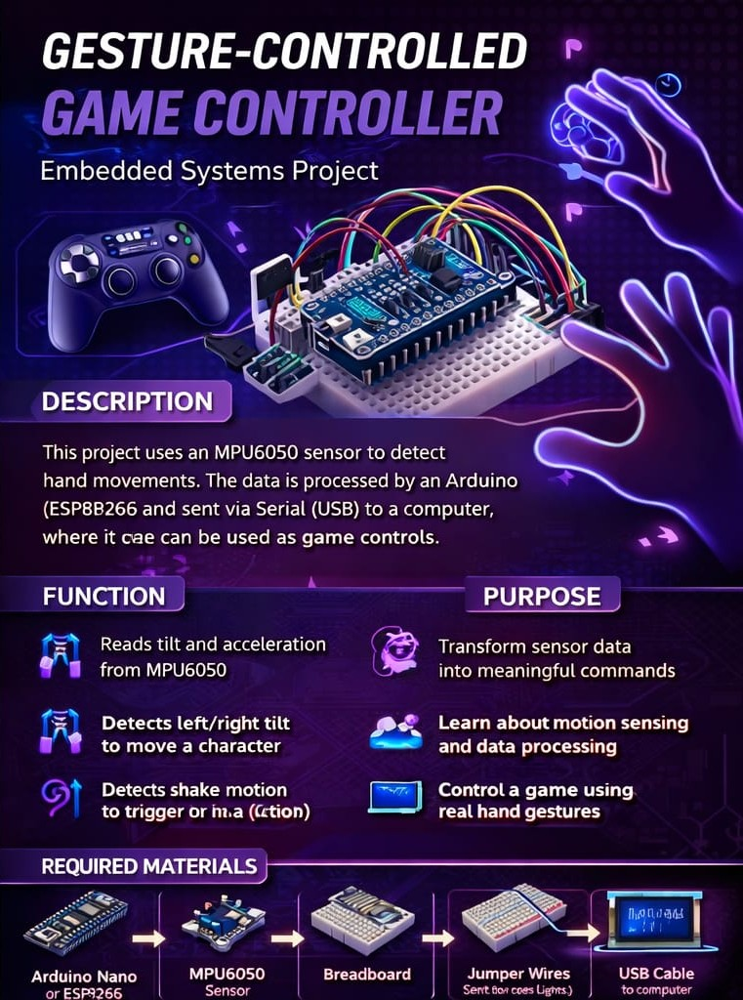

# 🎮 Gesture-Controlled Game Controller

> **Embedded Systems project** — steer a Unity character by tilting your hand. An MPU6050 IMU on an Arduino Nano turns tilt into commands and streams them to Unity over USB serial in real time.



---

## ✨ Features
- 📐 **Real-time tilt detection** — roll and pitch from the MPU6050 (accelerometer + gyroscope fusion via `MPU6050_light`)
- 🧭 **4-direction control** — `LEFT` / `RIGHT` / `FORWARD` / `BACK`, `IDLE` inside a ±15° dead zone
- ⚙️ **Auto-calibration on boot** — gyro & accelerometer offsets computed while the device lies flat
- ⏱️ **20 Hz command rate** — one command every 50 ms over 9600-baud serial
- 🧵 **Non-blocking serial reader in Unity** — background thread + lock, so the game loop never stalls on I/O

## 🧠 How it works
```
Hand tilt ──▶ MPU6050 (I2C) ──▶ Arduino Nano
                                 • calibrate on boot
                                 • roll / pitch every 50 ms
                                 • ±15° thresholds → command
                                        │  USB serial, 9600 baud
                                        ▼
                         Unity · SerialController.cs (background read thread)
                                        │  LastCommand (thread-safe)
                                        ▼
                         Unity · PlayerController.cs (CharacterController movement)
```

| Command | Condition | In-game effect |
|---|---|---|
| `LEFT` | roll < −15° | move left |
| `RIGHT` | roll > +15° | move right |
| `FORWARD` | pitch > +15° | move forward |
| `BACK` | pitch < −15° | move backward |
| `IDLE` | otherwise | stop |

## 🛠️ Hardware
| Component | Purpose |
|---|---|
| Arduino Nano (CH340 clone) | reads the sensor, sends commands over USB |
| MPU6050 (GY-521) | 6-axis IMU — acceleration + angular rate |

**Wiring (I2C):** VCC → 5V · GND → GND · SCL → A5 · SDA → A4

## 📁 Structure
```
firmware/gesture_controller/   # final Arduino firmware (tilt → commands)
tools/mpu6050_angle_test/      # bring-up sketch: prints raw X/Y/Z angles for calibration checks
Unity/Scripts/
├── SerialController.cs        # opens COM port, reads lines on a background thread
└── PlayerController.cs        # maps commands to CharacterController movement
docs/                          # infographic + project report
```

## 🚀 Run
**Arduino**
1. Install the `MPU6050_light` library (Arduino IDE → Library Manager)
2. Flash `firmware/gesture_controller/gesture_controller.ino` to the Nano
3. Keep the device flat for ~1 s while it calibrates

**Unity** (built with Unity 6000.4, URP)
1. Set *Api Compatibility Level* to **.NET Framework** (needed for `System.IO.Ports`)
2. Copy `Unity/Scripts/*.cs` into your project
3. Add `SerialController` to an empty GameObject and set the COM port (e.g. `COM3`)
4. Add `PlayerController` (requires a `CharacterController`) to the player and assign the `SerialController`
5. Close the Arduino Serial Monitor, press **Play**, tilt to move

## 🔧 Troubleshooting
| Problem | Fix |
|---|---|
| Nothing on the serial port | Check COM port / 9600 baud; install the CH340 driver for clone Nanos |
| Unity can't open the port | Close the Arduino Serial Monitor first |
| Character drifts | Reset the Nano while the sensor lies flat to recalibrate |
| Too sensitive / not sensitive | Change the `15.0` thresholds in the firmware |

## 🗺️ Next steps
- Shake gesture (acceleration magnitude) for jump/attack
- Wireless version with ESP32 + Bluetooth
- Analog speed proportional to tilt angle

---
**Author:** Serhat Tay
